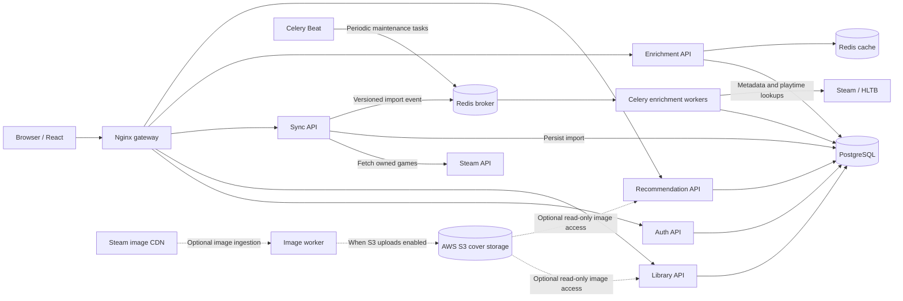

# Backlog Beater

**A game backlog manager built around reliable asynchronous processing.**

Backlog Beater helps players organize their Steam libraries, track completion progress, and enrich game records with external metadata and playtime estimates. Beyond the user-facing application, the project explores a practical backend problem: **how do you coordinate background work safely when messages are duplicated, workers fail, and multiple users request the same data?**

## What it does

- Imports Steam libraries and tracks owned games and progress.
- Enriches shared catalog entries with external game information and playtime estimates.
- Handles uncertain matches through candidate review and user-specific overrides.
- Runs slow external lookups asynchronously rather than blocking HTTP requests.
- Reuses catalog-level results while keeping personal progress and preferences separate.
- Supports optional AWS S3-backed cover-image storage and display, enabled for testing/demos rather than required for local development.

## Tech stack

| Area | Technologies |
| --- | --- |
| APIs | Python, FastAPI |
| Background jobs | Celery, Redis |
| Data storage | PostgreSQL; optional AWS S3 object storage for covers |
| Frontend | React |
| Gateway and deployment | Nginx, Docker Compose |
| External integrations | Steam and HowLongToBeat (HLTB) |

## Architecture




The application has separately containerized APIs for authentication, libraries, synchronization, and enrichment. PostgreSQL stores the shared catalog and durable job state; Redis brokers background messages and also supports review caching. Celery workers perform external lookups, while a periodic scheduler drives maintenance and recovery. The Sync API fetches libraries from Steam; the Library API ordinarily serves stored library data rather than requesting Steam on every read. Dashed S3 connections represent an **implemented but optional** image-storage path, not a required always-on dependency.

**Architectural tradeoff:** the services share a database and some models. This keeps local development manageable, but it is not a fully independent, database-per-service architecture.

See [architecture.md](architecture.md) for the full implementation details and [backend/README.md](backend/README.md) for operational information.

## Engineering highlights

### Durable, database-backed jobs

A job record is stored per shared catalog game. Instead of assuming that the queue itself represents job completion, the worker uses persisted states such as `READY`, `PENDING`, `RUNNING`, `COMPLETED`, and `FAILED`.

### Duplicate-delivery protection

Jobs carry an attempt token. A worker must atomically claim the matching pending attempt before performing work. Duplicate or stale messages cannot claim an already-running or completed attempt. Database locks and snapshot checks protect result persistence.

**Important distinction:** the design prevents competing executions for the same claimed attempt; it does not claim that Redis or Celery provides exactly-once message delivery.

### Failure recovery

Pending work is eligible for republishing after a cooldown. A scheduler also detects stale running attempts, and failed jobs can be explicitly retried. These mechanisms are intended to make worker or publication failures recoverable without silently losing all job state.

### Separation of shared and personal data

Shared game metadata and lookup results can be reused across users, while each user's completion status and match overrides are stored independently.

## Optional AWS S3 image storage

The application includes an **implemented S3 integration for game cover images**. It is intentionally **opt-in**: routine local development can run without enabling S3 uploads or supplying cloud credentials. I enable the S3 path when testing or demonstrating cloud-backed storage and display, and disable it otherwise to limit unnecessary cloud usage.

- **Upload path:** the image worker can ingest cover images and store them in S3 when uploads are explicitly enabled. [`compose.s3-upload.yml`](compose.s3-upload.yml) supplies a local AWS credential mount for this workflow; it **does not itself enable uploads**, and the upload flag defaults to off.
- **Display/read path:** the Library and Recommendation services can be configured for read-only S3 access using [`compose.s3-display.yml`](compose.s3-display.yml), independently of the upload override.
- **Credential separation:** the display override is designed for a restricted profile with `s3:GetObject` access to cover objects. AWS credentials should stay outside version control.
- **Cost control:** optional S3 functionality is not needed for normal local development. Disabling requests limits new activity, although already-stored objects may continue to incur storage charges.

**Architecture note:** S3 is a real integration, not a future proposal. The dashed arrows in the diagram indicate that the S3 paths are selectively enabled for demos/tests, not that the code is unimplemented. The diagram is simplified and does not attempt to depict each presigned URL or HTTP interaction.

## Reliability considerations and tradeoffs

**Already addressed in the implementation:** persistent job states, atomic claims, attempt-token fencing, duplicate-message handling, bounded dispatch batches, and stale-attempt detection.

**Known gap:** the sync service commits a library import before publishing its catalog event. A crash between those operations can leave committed data without the corresponding enrichment event; a later sync can resubmit it, but immediate recovery is not guaranteed. A transactional outbox or reconciliation process would address this gap.

**Further validation to publish:** reproducible performance measurements and fault-injection results. No latency, throughput, or uptime numbers are claimed here without a recorded benchmark.

## Running locally

This repository contains a root-level [Docker Compose configuration](compose.yml), an [.env.example](.env.example), and additional Compose configurations for specific workflows, including opt-in S3 upload and display.

1. Review [backend/README.md](backend/README.md) for prerequisites, environment variables, migrations, and service startup requirements.
2. Configure local environment variables using `.env.example` as a reference. Do not commit credentials.
3. Start the required services using the documented Compose workflow.
4. Follow the backend documentation to run migrations, tests, and any initial synchronization steps.

The setup instructions in the existing backend README remain the source of truth; this overview intentionally avoids assuming commands or credentials that have not been verified for a clean installation.

## Repository layout

```text
backend/             API services, workers, persistence, tests, and backend documentation
frontend/            User-facing application
gateway/             Reverse proxy configuration
scripts/             Development and operational scripts
architecture.md      Detailed system design and reliability notes
compose.yml          Primary local orchestration
compose.test.yml     Test-related orchestration
compose.s3-upload.yml Optional local S3 upload credential override
compose.s3-display.yml Optional S3 read-only display credential override
```

## What I'm exploring next

- Closing the sync-to-event dual-write gap with a transactional outbox.
- Tightening republish cooldown behavior and testing duplicate publication under concurrent dispatchers.
- Benchmarking queue throughput, job latency, and database performance under repeatable workloads.
- Publishing failure-injection experiments and clearer operational metrics.

## Documentation

- [System architecture and design tradeoffs](architecture.md)
- [Backend setup and operations](backend/README.md)

---

Built by [Rami Al-Azzawe](https://github.com/razzawe). This project is a place to explore backend engineering, asynchronous workflows, and distributed-systems reliability through a practical application.
