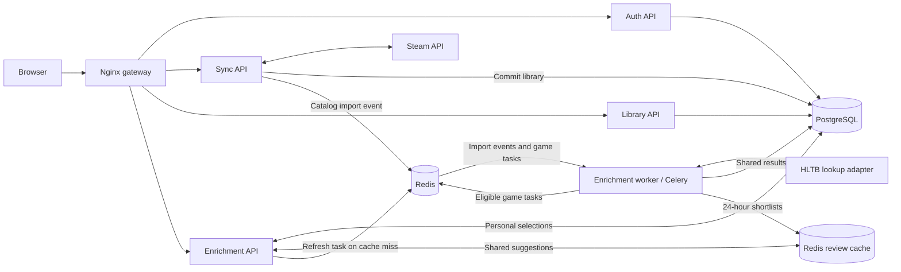

# Backlog Beater architecture

Last updated: October 11, 2026.

## Implemented architecture

Nginx serves the frontend and routes requests to separately containerized auth,
library, sync, and enrichment APIs. It authenticates protected requests through
the auth service and forwards verified user IDs. PostgreSQL holds the shared
catalog and user-specific ownership, progress, and HLTB overrides.

Enrichment has two runtime components: a FastAPI API for user decisions and a
Celery worker for background lookups. They have separate source folders, packages, Dockerfiles, and startup commands.
The worker reuses lookup/matching/persistence helpers from the enrichment codebase
but its image excludes the FastAPI API. Redis is the message broker, not a task executor.
The worker consumes the dedicated enrichment queue with concurrency one.

Sync uses its own Celery messaging client to publish one versioned
`catalog.games_imported` event after the database transaction commits. Its image
contains no enrichment implementation code. The enrichment worker consumes the
event, resolves Steam app IDs, checks eligibility, and schedules game tasks.

Each game task reads the title and previous lookup timestamp, closes its database
session, searches HLTB, then locks and reloads the game before saving. Changed
titles or intervening lookup records make its result stale. Saved shared results
are reused across users; personal overrides remain independent. Database row
locks protect writes but do not prevent duplicate queued tasks or searches.

## Implemented event-based flow

Sync announces committed imports through a message contract. Enrichment owns
eligibility and individual task submission. No HTTP call to the enrichment API
is needed for imports. Both event handling and game processing currently use the
same dedicated queue and worker; separate scheduling capacity remains optional.

The implemented contract is Celery task name `catalog.games_imported`, with
keyword arguments `schema_version: 1` and `steam_app_ids: [positive integers]`.
The consumer validates the version and IDs before querying the database. Duplicate
IDs within one event schedule a game only once. Overlapping events are not yet
deduplicated. Sync reports `enrichment.submitted` and `enrichment.unavailable`;
it does not know the number of eligible game tasks. Submission is not completion.
Redis queues deliver work to consumers; independent subscribers would require
explicit fan-out routing. This is a versioned message carried by Celery, not a
broadcast event bus.

## Responsibility boundaries

| Component | Responsibility |
| --- | --- |
| Auth API | Accounts, JWT verification, Steam identity linking |
| Sync API | Fetch and atomically import Steam libraries; announce committed imports |
| Library API | Return owned games and effective estimates; update personal completion progress |
| Enrichment API | Return saved ambiguous candidates and validate personal selections |
| Enrichment worker | Consume import events, determine eligible games, run HLTB lookups and persist outcomes |
| Redis broker | Hold queued messages for background workers |
| Redis review cache | Share top-three candidates for 24 hours and combine concurrent refresh requests |
| PostgreSQL | Store catalog metadata, lookup outcomes, ownership, progress, and personal overrides |

The browser calls the enrichment API through Nginx when a user opens match review
or selects a candidate. These endpoints read cached candidates. A cache miss queues a worker refresh
without performing an HLTB search in the HTTP request. Library responses prefer the user's personal override over shared
estimates. The library automatically refreshes every three seconds after a submitted sync
event, with progress based on persisted lookup outcomes. Per-game persistent
job status is not implemented; polling stops after completion or 15 minutes.

`Game` stores shared catalog fields and HLTB estimates. `GameEnrichment` stores
match outcomes and lookup timestamps; a separate Redis cache stores shared top-three
review shortlists for 24 hours. `OwnedGame` stores per-user completion
status. `PersonalHLTBOverride` stores per-user match selections. The shared
database and shared model package remain architectural coupling; this design
does not claim isolated databases for each service. Recommendation and image
workers remain future work.

## Planned reliability work

- Atomically claim one pending/running job per catalog game before queuing it.
- Keep job lifecycle separate from matched/ambiguous/no-match lookup outcomes.
- Recover broker submission failures and expired running jobs.
- Add bounded retries, request-rate control, and independent catalog backfill.
- Add a transactional outbox or equivalent durable dispatch/reconciliation to
  close the gap between committing an import and publishing its event.

These mechanisms are not implemented yet. Current submission is best effort;
later syncs can resubmit eligible games. Changing the producer to an event does
not by itself guarantee delivery or deduplicate work.

## Code map

- Sync trigger: [sync_service/main.py](backend/sync_service/main.py).
- Import event producer: [events.py](backend/sync_service/events.py).
- Enrichment event consumer: [tasks.py](backend/enrichment-worker/enrichment_worker/tasks.py).
- Worker configuration: [worker.py](backend/enrichment-worker/enrichment_worker/worker.py).
- Game task and eligibility: [tasks.py](backend/enrichment-worker/enrichment_worker/tasks.py).
- Lookup, matching, and persistence: [hltb.py](backend/enrichment-service/enrichment_service/hltb.py),
  [matching.py](backend/enrichment-service/enrichment_service/matching.py),
  [storage.py](backend/enrichment-service/enrichment_service/storage.py).
- Review endpoints: [api.py](backend/enrichment-service/enrichment_service/api.py).
- Containers and networks: [compose.yml](compose.yml).
- Operational setup: [backend README](backend/README.md).
