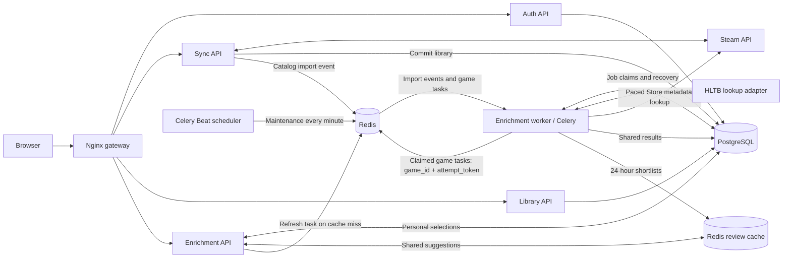
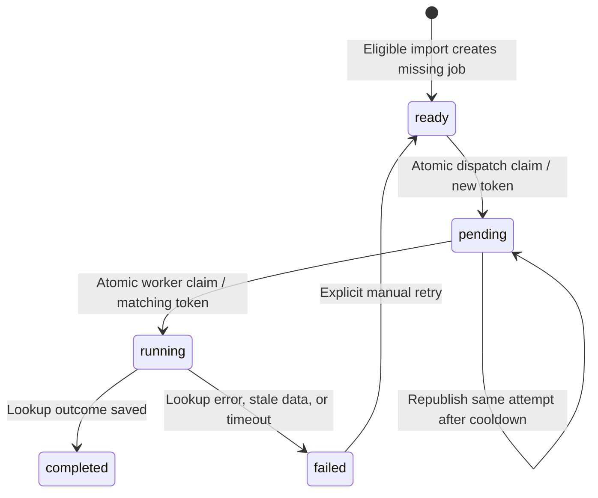

# Backlog Beater architecture

Last updated: October 24, 2026.

## Implemented architecture

Nginx serves the frontend and routes requests to separately containerized auth,
library, sync, and enrichment APIs. It authenticates protected requests through
the auth service and forwards verified user IDs. PostgreSQL holds the shared
catalog and user-specific ownership, progress, and HLTB overrides.

Enrichment has three runtime components: a FastAPI API for user decisions, a
Celery worker for background lookups, and a single Celery Beat scheduler for periodic maintenance. They have separate source folders, packages, Dockerfiles, and startup commands.
The worker reuses lookup/matching/persistence helpers from the enrichment codebase
but its image excludes the FastAPI API. Redis is the message broker, not a task executor.
The worker consumes the dedicated enrichment queue with concurrency two. HLTB and Steam metadata tasks share its two execution slots.

Sync uses its own Celery messaging client to publish one versioned
`catalog.games_imported` event after the database transaction commits. Its image
contains no enrichment implementation code. The enrichment worker consumes the
event, resolves Steam app IDs, checks eligibility, and schedules game tasks.

Each game task reads the title and previous lookup timestamp, closes its database
session, searches HLTB, then locks and reloads the game before saving. Changed
titles or intervening lookup records make its result stale. Saved shared results
are reused across users; personal overrides remain independent. Database row
locks protect result writes. Persistent job claims deduplicate scheduling and execution
across imports; a separate Redis lease also prevents overlapping game lookups while valid.

## Implemented event-based flow

Sync announces committed imports through a message contract. Enrichment owns
eligibility and individual task submission. No HTTP call to the enrichment API
is needed for imports. Both event handling and game processing currently use the
same dedicated queue and worker; separate scheduling capacity remains optional.



The implemented contract is Celery task name `catalog.games_imported`, with
keyword arguments `schema_version: 1` and `steam_app_ids: [positive integers]`.
The consumer validates the version and IDs before querying the database. Duplicate
IDs within one event are collapsed. Overlapping events share one database job
per catalog game and cannot create concurrent attempts. Sync reports `enrichment.submitted` and `enrichment.unavailable`;
it does not know the number of eligible game tasks. Submission is not completion.
Redis queues deliver work to consumers; independent subscribers would require
explicit fan-out routing. This is a versioned message carried by Celery, not a
broadcast event bus.

## Responsibility boundaries

| Component | Responsibility |
| --- | --- |
| Auth API | Accounts, JWT verification, Steam identity linking |
| Sync API | Fetch and atomically import Steam libraries; announce committed imports |
| Library API | Return owned games and effective estimates; update personal completion progress |
| Enrichment API | Return saved ambiguous candidates and validate personal selections |
| Enrichment worker | Consume import events, determine eligible games, run HLTB lookups and persist outcomes |
| Celery Beat scheduler | Publish periodic maintenance tasks; run exactly one scheduler |
| Redis broker | Hold queued messages for background workers |
| Redis review cache | Share top-three candidates for 24 hours and combine concurrent refresh requests |
| PostgreSQL | Store catalog metadata, lookup outcomes, enrichment jobs, ownership, progress, and personal overrides |

The browser calls the enrichment API through Nginx when a user opens match review
or selects a candidate. These endpoints read cached candidates. A cache miss queues a worker refresh
without performing an HLTB search in the HTTP request. Library responses prefer the user's personal override over shared
estimates. The library automatically refreshes every three seconds after a submitted sync
event, with progress based on persisted lookup outcomes. Persistent job status now
exists in the database but is not exposed through this UI; polling stops after
completion or 15 minutes.

`Game` stores shared catalog fields and HLTB estimates. `GameEnrichment` stores
match outcomes and lookup timestamps. `EnrichmentJob` tracks execution independently
in the `enrichment_jobs` table; a separate Redis cache stores shared top-three
review shortlists for 24 hours. `OwnedGame` stores per-user completion
status. `PersonalHLTBOverride` stores per-user match selections. The shared
database and shared model package remain architectural coupling; this design
does not claim isolated databases for each service. Recommendation and image
workers remain future work.

## Persistent enrichment jobs and deduplication

One `enrichment_jobs` row exists per shared catalog game, enforced by the
`game_id` primary key. It stores `status`, `attempt_token`, `updated_at`,
`last_published_at`, and `last_error`. Two owners importing the same game share
this work; their personal progress and HLTB selections remain independent.



1. `games_imported` resolves eligible catalog games and inserts missing ready jobs
   with `ON CONFLICT DO NOTHING`. Imports never reset an existing job.
2. Dispatch locks a bounded batch using `FOR UPDATE SKIP LOCKED`, changes ready
   jobs to pending, assigns random attempt tokens, and commits before publication.
   Only ready jobs create new attempts. Each lookup message contains only
   `game_id` and `attempt_token`.
3. A worker conditionally updates pending to running for that game and token.
   If no row matches, it skips the message before contacting HLTB. Duplicate or
   outdated deliveries cannot claim an already running or finished attempt.
4. Before saving, the worker locks and validates the running attempt, then locks
   the game and checks the title/lookup snapshot. Enrichment writes and the job's
   final transition commit together. An old attempt cannot overwrite a newer one.
5. Successful lookups become completed jobs, including ambiguous and no-match
   outcomes. Lookup failures become failed jobs. Unexpected exceptions record
   `task_error`; skipped/stale work records its corresponding failure code.

Celery Beat publishes maintenance every minute. The worker processes at most 100
jobs per dispatch call. Pending rows act as durable dispatch intent: publication
failures or crashes leave them recoverable. Publication reservations are committed
before broker access to throttle concurrent dispatchers and failures. Pending
attempts may be republished after five minutes with the same token; a long queue
wait does not expire or replace them. Duplicate messages are allowed, but their
execution is guarded by the database claim.

Running attempts older than two minutes are marked failed with `worker_timeout`,
comfortably beyond the current 35-second task hard limit. Failed jobs stay in
PostgreSQL after terminal failures or exhaustion. Identifiable temporary HLTB
errors can schedule another ready attempt as described below. `retry_failed(game_id)` atomically
changes failed to ready and clears the old token, error, and publication time.
Maintenance then assigns a fresh token and dispatches it. Concurrent calls only
reset the row once, but the helper does not yet accept an expected failed token
to protect against a delayed request arriving after a later attempt also fails.
There is no HTTP retry endpoint or Retry button yet.

These job records cover `enrichment.enrich_game`. User-triggered
`enrichment.refresh_review` tasks continue using the existing token-owned Redis
lease independently: 15 minutes pending, 60 seconds running, with owner-checked
cache publication and release. Personal overrides survive cache expiry.

## Deployment and remaining reliability work

Migration `006_add_enrichment_jobs.sql` creates the table and index without
backfilling or enqueueing existing games. Apply it before deploying the updated
worker, drain old lookup messages that lack attempt tokens, and start exactly
one `enrichment-scheduler`. Validated October 24, 2026: all 128 backend tests pass against isolated PostgreSQL
and Redis. Coverage includes concurrent scheduling/execution claims, duplicate
deliveries, publication recovery, timeout/manual retry, and stale-worker result
fencing. Migration 006 was executed twice in an isolated schema and verified to
preserve existing data, avoid automatic backfill, and enforce primary-key,
foreign-key, and status constraints. The application database has not been migrated
or the updated worker deployed as part of this validation.

The sync-to-catalog event remains best effort: a crash or publication failure
after the library commit but before job creation is not recovered by job
maintenance. Repeat sync can resubmit eligible games. A sync-side transactional
outbox or equivalent reconciliation is still needed to close that gap.

Remaining work includes explicit HLTB catalog backfill, job-based UI progress,
and broader failure detection where the HLTB wrapper hides HTTP details. Steam metadata
pacing and bounded backfill are implemented below. HLTB pacing and bounded temporary-failure retries are now implemented below.

## Code map

- Sync trigger: [sync_service/main.py](backend/sync_service/main.py).
- Import event producer: [events.py](backend/sync_service/events.py).
- Enrichment event consumer: [tasks.py](backend/enrichment-worker/enrichment_worker/tasks.py).
- Job claims, dispatch, recovery, and retry: [jobs.py](backend/enrichment-worker/enrichment_worker/jobs.py).
- Job model: [database.py](backend/app/database.py).
- Job migration: [006_add_enrichment_jobs.sql](backend/migrations/006_add_enrichment_jobs.sql).
- Worker configuration: [worker.py](backend/enrichment-worker/enrichment_worker/worker.py).
- Game task and eligibility: [tasks.py](backend/enrichment-worker/enrichment_worker/tasks.py).
- Lookup, matching, and persistence: [hltb.py](backend/enrichment-service/enrichment_service/hltb.py),
  [matching.py](backend/enrichment-service/enrichment_service/matching.py),
  [storage.py](backend/enrichment-service/enrichment_service/storage.py).
- Review endpoints: [api.py](backend/enrichment-service/enrichment_service/api.py).
- Containers and networks: [compose.yml](compose.yml).
- Operational setup: [backend README](backend/README.md).

## Steam metadata: schema foundation

Migration 007 and the shared models now define two tables for recommendation
metadata. `game_metadata` stores one row per catalog game: nullable
`single_player`, JSON `genres` (stable string IDs and display names),
`last_lookup_at`, `last_success_at`, and `last_error`. Metadata is collected once
after a successful lookup; no automatic refresh is scheduled.
NULL game mode means unknown; `last_success_at` distinguishes uncollected data
from a successfully collected empty genre list. Genres must be a JSON array;
validation of individual entries will be implemented in the Steam adapter.

`game_metadata_jobs` separately tracks one collection job per game using the
existing five states, an attempt token, update/publication times, and last error.
Both tables reference the shared catalog and preserve HLTB data and user data.
The migration creates no records and starts no work.

The Steam adapter is implemented in `metadata_worker/steam_metadata.py`.
`catalog.games_imported` now commits missing metadata jobs alongside HLTB jobs,
then dispatches `catalog.collect_metadata(game_id, attempt_token)` on the same
queue. Missing or failed metadata is never classified as multiplayer-only.
Successful collection is reused indefinitely; imports never reset existing jobs.

`metadata_jobs.py` uses independent ready/pending/running/completed/failed claims
and token fencing, with the same five-minute publication cooldown and two-minute
running timeout as HLTB jobs. Maintenance is separately scheduled every minute.
Pending publication recovery can produce duplicate messages, but only one worker
can claim each attempt. Failed metadata jobs require explicit `retry_failed`;
there are no automatic retry cycles or HTTP retry endpoint.

The metadata task claims before fetching, reads the Steam ID without holding a
transaction during I/O, then rechecks its token and catalog identity under locks.
Metadata writes and job completion share one transaction. Failures preserve
previous verified metadata; unexpected exceptions fail the owned attempt.
A 25-second soft / 30-second hard task limit bounds execution.

One worker container runs with concurrency two. `steam_pacing.py` uses an atomic
Redis `SET NX PX` slot on the broker to permit at most one metadata request start
per second across processes. Slot acquisition waits at most five seconds and
fails closed if Redis is unavailable. This is a local conservative pacing policy,
not a claimed Steam quota; it is independent of HLTB and Steam library syncing.
Each prefork child resets its PostgreSQL connection pool.

`python -m metadata_worker.backfill_metadata --limit 100 --after-id 0`
explicitly creates missing jobs in catalog-ID order. Limit is bounded to 1..1000;
output includes a cursor. Existing jobs and successfully collected metadata are
excluded. Dispatch publishes at most 100 per call; maintenance handles the rest.
Nothing automatically backfills the catalog on startup. Migration 007 must be
applied before deploying this code; application deployment remains separate.

Schema validation (October 24, 2026): all 130 backend tests pass against isolated
PostgreSQL/Redis, including metadata model round trips, independent job states,
migration 007 reruns, preservation of populated catalog/user/HLTB/queue tables,
and database constraints. The JSON-array constraint is PostgreSQL-specific so
SQLite-based service tests remain supported. Migration 007 has not been applied
to the application database.

Metadata integration validated October 24, 2026: all 148 backend tests pass
against isolated PostgreSQL/Redis. Coverage includes dispatch deduplication,
token-checked persistence, stale attempts, failure/republication/timeout recovery,
one-time collection, bounded backfill, and shared request pacing. Compose
configuration validation passes. No application migrations, deployment, live
Store backfill, or live-worker concurrency QA was performed in this step.

## Local metadata deployment verification — October 24, 2026

Migrations 006 and 007 applied successfully to the local application database
following a custom-format backup at `/tmp/backlog-before-metadata.dump`.
Rebuilt and started the worker and scheduler without recreating other services.
The enrichment queue was empty before the upgrade. Worker inspection confirmed
prefork concurrency two and both execution slots processed live metadata jobs.

A bounded five-game backfill created and published five jobs (last catalog ID 5).
All five completed with no errors and persisted genres: Half-Life 2 and Portal 2
reported single-player support; Half-Life 2: Deathmatch, Half-Life Deathmatch:
Source, and Team Fortress 2 reported no declared single-player support. This was
a small live verification, not a full-catalog backfill or recommendation rollout.
The backup is local temporary storage; copy it to durable storage if retaining it.

Live scheduler verification: both HLTB and metadata maintenance tasks were
published at the first one-minute interval and completed successfully with zero
additional jobs dispatched.

## HLTB pacing and temporary-failure retries

Both ordinary enrichment and review refresh tasks share the Redis gate in
`enrichment_worker/hltb_pacing.py`. It permits one active whole lookup and at
least three seconds between lookup starts. An owner token protects release;
a 45-second lease outlasts the 35-second hard task limit and recovers crashes.
This limits wrapper lookups, not every underlying HTTP request: wrapper 1.0.24
performs discovery/auth/search requests and hides some HTTP failures as `None`.
Three seconds is our conservative setting, not a published provider quota.

Busy or unavailable gate: use Celery countdown retry with the same job/token,
remaining gate wait plus jitter (ten seconds if Redis is unavailable), without
claiming running or consuming a processing attempt. Redis failures fail closed.
Release the gate in `finally`. Pending PostgreSQL records remain recoverable by
maintenance if publishing a deferred task fails. Countdown tasks may be reserved
in worker memory until due; they do not occupy a processing slot while waiting.

Migration 008 adds `attempt_count` and `next_attempt_at` to HLTB jobs. A successful
pending-to-running claim increments the processing count. Identifiable temporary
failures (timeouts, connection errors, exposed 429/5xx responses) get at most
three processing attempts per cycle. The first failure sets ready with a due time
at least one minute away; the second waits at least five minutes. Maintenance
honors the due time, assigns a new token, and dispatches; its one-minute schedule
and queue backlog can add delay. The third failure stays failed. Manual
`jobs.retry_failed(game_id)` resets the count and due time for a fresh cycle.
No-match and ambiguous outcomes remain completed. Malformed data, opaque wrapper
failures, and other errors are terminal; they are not assumed temporary.

Identifiable temporary failures also set a shared provider cooldown of at least
one minute. Exposed Retry-After seconds/date values extend the retry delay and
global cooldown. The wrapper may hide the actual status/header, so this cannot
promise detection of every throttling response. Successful existing results and
personal overrides are preserved.

Review refreshes use the same gate and three-attempt policy, with a failure count
in their task arguments and a newly claimed per-game refresh token after each
failed lookup; busy-gate deferrals retain their current token. Review retry state
remains in Celery/Redis rather than the HLTB job table. Expired running jobs still
become failed through maintenance; crashes are not blindly classified transient.
Steam metadata retry behavior is unchanged (explicit retries only).

Apply migration 008 before deploying the updated worker. Existing failed games
are not automatically restarted or backfilled by the migration or deployment.

HLTB limiter validation/deployment (October 24, 2026): all 154 backend tests pass,
including Redis gate ownership/spacing/cooldown, busy-task deferral without claims,
three-attempt backoff/manual reset, retryable HTTP classification, review deferral,
and migration 008 reruns. Migration 008 was applied locally after backup to
`/tmp/backlog-before-hltb-retries.dump`; worker and scheduler were rebuilt and
restarted successfully. No automatic catalog rerun or reset of failed jobs was
performed. Live external HLTB load was not generated for verification.

### Queue split: step 1 (routing only)

The Celery app now declares `steam_metadata` alongside `enrichment` on the same
Redis broker. Metadata dispatch explicitly publishes `catalog.collect_metadata`
to `steam_metadata`; task routes and the Beat metadata-maintenance entry also
select that queue. Import events and HLTB tasks retain the `enrichment` default.
Backfill uses metadata dispatch and therefore follows the new queue automatically.

This is a staged source change: no metadata worker container has been added yet,
no concurrency or HLTB gate behavior changed, and the application remains stopped.
Do not deploy this intermediate configuration alone: metadata messages need the
separate consumer from the next step. Existing messages already in Redis are not
moved by changing routing. No migration is required.

### Queue split: step 2 (metadata worker configuration)

Compose now defines `metadata-worker`, built from the existing
`enrichment-worker/Dockerfile` and using the same Celery app/task modules.
It subscribes only to `steam_metadata`, uses concurrency one, and identifies
itself as `metadata@%h` with a targeted ping health check. It has database,
broker, and outbound network access; it does not require the HLTB review cache.
No separate HTTP API, broker, task implementation, or schema is added.

This step only adds container configuration. The app has not been started or
redeployed. The HLTB worker concurrency and gate changes remain step 3.

### Metadata source separation

Metadata code now lives in `backend/metadata-worker/metadata_worker/`: `tasks.py`,
`worker.py`, `metadata_jobs.py`, `steam_metadata.py`, `steam_pacing.py`, and
`backfill_metadata.py`. It has its own `backend/metadata-worker/Dockerfile`.
Compose's metadata worker and health check use `metadata_worker.worker:app`.
Task names, Redis queue names, database schemas, and attempt-token behavior are
unchanged. The existing Beat scheduler still routes metadata maintenance to
`steam_metadata`; no second scheduler is required.

The import-event handler remains in the enrichment package and imports metadata
job creation/dispatch helpers. Its image includes the metadata package for that
explicit dependency, but no longer defines metadata task execution in its own
`tasks.py`. The metadata image does not copy HLTB enrichment implementation.
The test environment includes the new metadata package path. No app containers
have been started or redeployed for this source move; the HLTB concurrency/gate
change remains a separate next step.

Metadata source move validation: 155 backend tests pass; both worker images
build and pass offline import smoke checks. Compose validation passes. The app
remains stopped; no migration or live task processing was performed.

### Queue split: step 3 — sequential HLTB execution

The HLTB Compose worker and Dockerfile default now use concurrency one.
Metadata remains in its separate concurrency-one container/queue. Run exactly
one HLTB worker instance: serialization now comes from its execution slot,
not a global active-lookup lease. Scaling HLTB requires revisiting that policy.

`hltb_pacing.wait_for_slot()` atomically enforces three-second start spacing
in Redis, sleeping locally only for short spacing. The obsolete 45-second
active-lookup key is ignored; there are no busy-worker gate deferrals, tokens,
or release calls. Database job tokens and per-game review leases remain intact.
HLTB still may issue several underlying HTTP requests per wrapper lookup.

Long provider cooldowns defer via Celery countdown with jitter, keeping the job
pending without consuming an attempt. This avoids sleeping past the existing
30/35-second task limits; it is distinct from the removed busy-gate retries.
Redis coordination failures also defer without calling HLTB. Temporary lookup
failure backoff, Retry-After handling, and the three-attempt budget are unchanged.
Metadata pacing is unchanged. No schema migration is needed.

This step changes source/configuration only. The app remains stopped. Existing
queued/ETA messages are not purged or moved; an old deferred message may retain
its previously assigned delay until delivered. Deploy both worker images and
queue consumers together in the next step.

Step 3 validation: all 156 backend tests pass, including local spacing, ignoring
the obsolete active lease, cooldown preservation, deferral without processing
claims, and Redis failure handling. Compose configuration and compilation pass.
The app remains stopped; live deployment verification is next.

Worker split deployed locally October 24, 2026: all app images rebuilt, local
application rows/IDs and Redis queue/cache state reset, and the full stack
started. Gateway returns HTTP 200. Live worker inspection confirms enrichment
consumes only `enrichment` and metadata consumes only `steam_metadata`, both
with concurrency one. Both workers and API/database/cache health checks pass.
The database was verified empty; a new account/link/sync is required to observe
fresh tasks. No live provider lookups were triggered during this reset check.

### Steam cover source correction

The metadata adapter now validates optional `header_image` URLs (HTTPS, explicit
Steam CDN host allowlist, no credentials or custom ports). Missing/invalid artwork
does not discard otherwise valid metadata. On successful collection, the task
stores the returned URL in `Game.cover_url` only if the previous cover is missing
or equals the constructed legacy fallback for that app. Other saved/custom covers
are preserved. Sync uses the constructed URL for new games and missing covers,
but no longer overwrites existing URLs on repeat imports.

This fixes newer Store asset paths where the legacy URL serves a gray placeholder
with HTTP 200. Existing completed metadata jobs are not automatically rerun; cover
repairs are explicit. No migration or S3 changes are required. Future image
processing can download this verified source and store an S3 key separately.
All 159 backend tests pass, covering URL validation, fallback replacement,
preservation of custom covers, and preservation across repeat syncs.

Cover fix deployed locally: sync and metadata images rebuilt, gateway reloaded,
and only Battlefield 6 (Steam app 2807960) explicitly repaired from its legacy
fallback to Steam's current header_image. Other existing covers were not backfilled.

### Library game-mode filters

The library toolbar now offers All game modes, Single-player, Multiplayer,
Single-player only, Multiplayer only, and Unknown mode, combined with progress,
search, and sort. It displays matching/total counts. Mixed-mode games appear
under both supported modes; exclusive filters require explicit false for the
other mode. Missing data is unknown and never inferred from names or failures.

Migration 009 adds nullable `game_metadata.multiplayer`. The Store adapter reads
category ID 1 independently of single-player category ID 2. Valid category arrays
produce booleans; absent categories preserve unknown. Library list and progress
update responses expose both fields without per-game queries or provider calls.

Existing completed metadata is not automatically refreshed. To explicitly fill
only mode fields for previously collected records, use a bounded batch:
`docker-compose exec metadata-worker python -m metadata_worker.backfill_modes --limit 100 --after-id 0`.
It uses shared Steam pacing, preserves covers/genres/progress/HLTB data, and
reports updated/failed counts plus a cursor. Normal metadata collection stores
both modes for new games. No HLTB re-enrichment is required.

Game-mode filtering validated/deployed October 24, 2026: 162 backend and 10
frontend tests pass. Migration 009 applied locally after backup at
`/tmp/backlog-before-game-modes.dump`; library and metadata services rebuilt.
Authenticated library verification returns HTTP 200 with both mode fields for
115 games. The explicit mode-only backfill filled 105 records with no request
failures; 10 remain unknown. Stored totals: 82 single-player, 81 multiplayer,
59 supporting both. Counts overlap by design. Covers/genres and HLTB work were
not backfilled. Visual browser QA remains pending.

## Recommendation service — step 1: request contract

`backend/recommendation_service/` now contains an independent FastAPI app with
`GET /internal/health` and a `RecommendationRequest` model in `api.py`.
Preferences require finite numeric weekly hours greater than zero and at most
168, and an integer target window of 1..52 weeks. Boolean/string numeric inputs
are rejected. The budget is their product. Completion goal defaults to
`main_story`, with `main_extra` and `completionist` supported. Up to 20 distinct
canonical positive string genre IDs are allowed; no selected genres is valid.
Unknown request fields are rejected. Genre membership validation against stored
metadata belongs to the future database-backed endpoint, not this syntax model.

The recommendation route, repository, ranking, Dockerfile, Compose/Nginx wiring,
and frontend are not implemented in this first step. No app deployment or schema
migration was performed. The agreed MVP uses request-only preferences, strict
time eligibility, and includes Play Next games without modifying their order.
History-based affinity and ratings are deferred.

Recommendation step 1 validation: all 167 backend tests pass, including preference
input boundaries and the standalone health endpoint. No recommendation endpoint
or runtime container has been deployed yet.

## Recommendation service — step 2: pure ranking

`recommendation_service/ranking.py` defines immutable Candidate/Recommendation
records and `rank_candidates(candidates, preferences)`. Candidates must already
be ownership-scoped and carry effective whole-set personal/shared estimates;
repository resolution is the next step. No database/provider calls occur here.

Eligibility requires not-started progress, explicitly verified single-player
support, a resolved match, and a finite positive estimate for the requested
completion category within the strict hours/week × weeks budget. Missing
categories are never substituted and estimates are not rounded before filtering.
Play Next is included; saved queue positions are returned without scoring or
mutation. Ranking sorts by descending fraction of preferred genres matched,
then descending budget utilization, then ascending game ID. No selected genres
means time-only ordering. At most three distinct games are returned. Identical
duplicates collapse; conflicting duplicate records raise rather than silently
selecting an arbitrary estimate.

Results include cover/title, source, matched genre IDs, hours, approximate weeks,
queue position, and factual reasons with the full-weekly-budget assumption.
The endpoint, database repository, container, gateway wiring, and frontend remain
unimplemented. This step has no deployment or schema changes.

Recommendation ranking validation: all 173 backend tests pass, including the
exact 12-hour boundary, invalid/missing estimates, category selection, mode and
progress eligibility, genre-first ordering, empty preferences, stable ties,
queued/personal estimates, and distinct results. No runtime deployment occurred.

## Recommendation service — step 3: repository

`recommendation_service/repository.py` loads ownership-scoped Candidate records
with one SELECT joining shared games, personal progress, Steam metadata, lookup
outcomes, personal HLTB overrides, and Play Next membership. Both personal joins
are constrained to the ownership user; another owner's override/queue position
cannot affect a candidate. Missing metadata stays unknown. Malformed genre IDs
are ignored, and candidates are ordered by catalog ID.

A personal override replaces the complete estimate set, including missing values.
It resolves shared ambiguity for that owner. Without an override, a shared HLTB
ID is resolved only if its lookup outcome is matched, or if no outcome row exists
for a legacy saved match. Explicit ambiguous/no-match/lookup-failed outcomes do
not resolve merely because an ID is present. Ranking remains responsible for
progress, mode, selected-category, and budget eligibility.

The repository performs no writes/provider calls or imports from other service
implementations. The authenticated endpoint, supported-genre membership check,
Dockerfile, Compose/Nginx, and frontend are still future steps. No app deployment
or schema change was performed in this repository step.

Recommendation repository validation: all 178 backend tests pass, including
user isolation, whole-set override precedence, ambiguity resolution, missing
metadata, one-SELECT loading, and unchanged personal queue/progress. No runtime
deployment occurred.

## Recommendation API and container

The read-only `recommendation` Compose service uses its own Dockerfile/package,
internal gateway/database networks, and a health check. Nginx exposes only the
exact protected `POST /api/v1/recommendations` route, using existing auth_request
identity forwarding and stripped downstream bearer credentials. No HTTP port is
published for the service; no schema migration or worker task is required.
Nginx startup waits for recommendation health. Start the service before reloading
Nginx when upgrading an existing deployment.

Example request (use a valid account bearer token):

```json
{
  "weekly_hours": 4,
  "target_weeks": 3,
  "preferred_genres": ["1", "25"],
  "completion_goal": "main_story"
}
```

The response includes `available_hours`, up to three `recommendations`,
`empty_reason`, and ownership-scoped `coverage`. Each recommendation contains
catalog ID/title/cover, selected estimate hours, approximate weeks, personal/shared
source, matched genre IDs, zero-based saved queue position (or null), and factual
reasons including the full-budget assumption. Queued games remain eligible; no
queue/progress changes occur. Genre fit sorts before time fit and game ID.
Preferences are request-only. Supported genres are canonical IDs present in stored
shared metadata; unsupported IDs return 422. Empty genre preferences are valid.

Empty reasons are `empty_library`, `no_eligible_games` (progress, mode, resolved
match, or selected estimate unavailable), or `no_games_within_budget`. Coverage
reports owned games, verified single-player games, eligible games before budget,
and games within budget, without silently relaxing preferences or time limits.
No Steam/HLTB calls or imports from other service implementations occur.
`schemas.py` holds request validation so pure ranking does not depend on routing.

Validation: all 183 backend tests pass. Live Nginx checks confirm unauthenticated
and invalid/spoofed credentials return 401, valid authentication returns 200,
client X-User-ID is overwritten, returned games are owned and within 12 hours,
invalid preferences/unknown genres return 422, and internal health stays unrouted
(404). The real library returned three suggestions from 19 within-budget games,
with 115 owned / 82 verified single-player / 41 eligible before budgeting.
The image builds and its container health check passes. No frontend is added yet.

After live verification, the temporarily started app dependencies and new
recommendation container were stopped to restore the original runtime state.
Existing worker containers were not started and no game jobs were resubmitted.

## Recommendation UI

The existing library page now includes a responsive Pick my next game panel.
It accepts weekly hours, target weeks, optional genre checkboxes, and completion
goal, with a live calculated budget. Authenticated GET /api/v1/recommendations
returns validated stored genre choices; POST retains its recommendation contract.
No provider calls occur. If genre loading fails, time-only recommendations remain
available and an explicit Reload genres action retries the choices request.

Results show up to three covers/titles, selected estimate hours, approximate
weeks, estimate source, factual reasons, and existing Start Playing / Add to Play
Next actions. Existing queued games are labelled, actions respect current progress,
and no queue reorder/start occurs without a click. Loading, API errors, empty
library, missing eligibility, and strict-budget empty results have explicit states.
Budget assumptions are visible and constraints are never relaxed automatically.

The UI uses text nodes for server-provided titles/reasons, accessible field labels,
status/error announcements, image fallbacks, and single-column mobile results.
Requests are scoped to account generation and submission sequence; editing
preferences invalidates previous results and in-flight responses, and logout
clears cards/preferences so late responses cannot restore another session's data.
The standalone recommendations.js module reuses the app's authenticated API and
existing ownership-checked plan actions.

Validation: 184 backend tests, 12 frontend tests, and isolated Playwright desktop/
mobile checks pass. Browser checks use mocked API responses and verify preference
payloads, cards, both plan actions, mobile overflow, errors/empty states, preference
edits during requests, logout races, and no browser errors. Screenshots are saved
at /tmp/backlog-recommendations-desktop.png and /tmp/backlog-recommendations-mobile.png.
Real-account recommendation API gateway checks passed in the earlier milestone;
a new real-account end-to-end browser run remains separate QA. No new migration.

### Compact genre picker

Recommendation genres now use a native expandable dropdown with search,
selected checkboxes inside the menu, removable chips outside it, and Clear
selection. The closed control shows Any genre or a selection count; no genres
remains a valid time-only preference. Selection is capped at 20. Search text
filters choices without changing the request or invalidating existing results;
actual selection changes retain normal stale-result protection. Escape closes
the menu and restores summary focus, and outside clicks close it. Recommendation
tiles and API/ranking behavior are unchanged.

Validation: 12 frontend tests and mocked desktop/mobile browser checks pass,
including genre search/no matches, chip removal, keyboard Escape, preference
payloads, result actions, and stale responses. Static assets are served directly
by the running frontend; refresh the page to load the picker. No container or
backend changes are required.

## Recommendation pagination

POST /api/v1/recommendations accepts an optional strict nonnegative integer
`offset` (default 0, maximum 1000000) and returns three ranked games starting
there. Response `pagination` includes offset, limit (3), total qualifying games,
and has_more. An offset beyond the current list returns no cards with no false
claim that no games qualify; empty_reason describes eligibility only when the
qualifying total is zero. Eligibility, genre-first/time-fit ranking, identity
checks, and personal override precedence are unchanged.

The UI adds Back / Show next 3, shows the current range and total, and disables
navigation during requests and at boundaries. Page navigation reuses submitted
preferences, not unsaved edits, and never changes Play Next. Preference edits or
logout clear pagination. Progress changes invalidate navigation and prompt a
fresh search, avoiding offset shifts after starting/finishing a suggestion.
Each request reads current library data, so background metadata changes can
alter later results; this is deterministic offset pagination, not a persisted
ranking snapshot. A fresh search always starts at offset zero.

Validation: 186 backend tests, 12 frontend tests, and mocked desktop/mobile
browser checks pass. Navigation checks cover 1–3, 4–6, a final one-game page,
Back, disabled boundaries, preserved preferences, and existing action/race tests.
No schema change or external provider calls are added.

Pagination deployed locally: rebuilt recommendation service, validated/reloaded
Nginx, and verified authenticated offsets 0 and 3 return distinct game groups
from 19 qualifying real-library games. The app remains running.

### Smooth recommendation page loading

Pagination keeps current cards, page range, and result summary visible during
requests. Navigation and card actions disable briefly, with a small reserved-width
Loading indicator beside the range. The results container retains its measured
minimum height across page changes, preventing collapse on short/final pages.
Cards swap together after a successful response. Failed requests preserve the
current results and range, display an inline error, and provide Retry loading
results for the requested offset. Preference edits/logout clear retained results
and height; stale responses remain rejected. No API or ranking changes.

Validation: all 12 frontend tests and mocked desktop/mobile browser checks pass,
including delayed Next requests retaining card IDs/height and disabled navigation,
failed Next preserving cards/range, explicit retry, page boundaries, plan actions,
preference edits, and logout races. Static frontend changes are available on refresh.

## Recommendation exclusions: free-to-play and personal hiding

Migration 010 adds nullable Steam `is_free` metadata and a per-owner
`recommendation_hidden` boolean (default false). Steam metadata accepts explicit
boolean `is_free` only; absent/malformed fields remain unknown. Recommendations
exclude verified free games by default, with strict boolean request option
`include_free_games` to opt in. Unknown status is not guessed from genre, price,
name, ownership cost, or lookup failures. The UI explains that unknown pricing
may still appear. No automatic subjective quality classification is performed.

A recommendation card's Hide from recommendations action saves a persistent
ownership preference via the library-owned, gateway-protected
PUT /api/v1/games/{game_id}/recommendation-preference with {"hidden":true}.
Requests require ownership and strict booleans; repeated identical requests are
idempotent. Hidden games are always excluded, even when including free titles.
The game remains owned and its completion status, HLTB override, cover, and Play
Next membership/order are preserved. Repeat imports do not reset the preference.
Show in recommendations on the library card restores it with {"hidden":false}.
Hiding refills the recommendations from offset zero; it does not reorder queues.

The recommendation service remains read-only; the library service owns personal
preference mutations. Coverage and page totals use the same free/hidden filters
as ranking. Metadata persistence collects free status for future successful jobs.
Existing completed records can be explicitly upgraded with the bounded command:
`docker-compose exec metadata-worker python -m metadata_worker.backfill_free --limit 100 --after-id 0`.
This uses shared Steam pacing and updates only the free flag, preserving other
metadata. It reports updated/failed counts and a cursor. Failed/unavailable Store
entries stay unknown; no HLTB catalog rerun is triggered.

Exclusions validation: all 199 backend and 12 frontend tests pass, including
migration reruns/defaults, explicit free booleans, opt-in behavior, hidden-game
exclusion even with free games included, ownership isolation, idempotent hide,
restore, repeat-sync preservation, and field-only backfill preservation. Mocked
desktop/mobile browser checks cover the opt-in payload, Hide/refill, library
restore, and existing pagination/action/race flows. Migration 010 applied locally
after backup at /tmp/backlog-before-recommendation-exclusions.dump; library,
metadata worker, and recommendation services rebuilt and Nginx reloaded.
Live gateway hide/restore verification passed and restored the test preference.

Free-status backfill completed locally: 105 records updated, zero request
failures, 30 verified free titles, and 10 unknown records. Only the free flag
was updated; no automatic HLTB rerun or removal of ownership occurred.

## Library defaults and maintenance presentation

The library grid now defaults to Not started and hides Steam-verified free games.
Show free-to-play games is an explicit opt-in independent of recommendation
preferences; unknown free status stays visible rather than being guessed. The
library API exposes nullable `is_free` in list and completion-update responses.
Filtering is client-side so ownership, saved progress, Currently Playing, and
Play Next entries remain intact. Main library totals and maintenance counts use
the free-game visibility setting. Search, game mode, sort, and progress still
combine normally. Clear filters returns to Not started with free games hidden;
signing out resets these controls for the next account.

Needs review and Missing completion data now live inside a collapsed Library
maintenance section, selected by the user during implementation. Each view keeps
its count, explanatory row, candidate review flow, and existing assessment copy.
No new migrations or provider requests are needed.

Validation: 199 backend tests, 13 frontend tests, and mocked desktop/mobile
browser checks pass. Browser assertions cover the initial Not started selection,
collapsed maintenance, review access, free-game opt-in, All games/progress
combinations, and recommendation actions/pagination. The library image was
rebuilt so the frontend receives free flags; refresh to load the static UI changes.

### Conflicting free flags and explicitly named test builds

Shared `app/catalog_filters.py` treats either explicit Steam `is_free=true` or
Steam's Free To Play genre ID 37 as free-to-play. This deliberately resolves
cases such as AltspaceVR (`is_free=false`, genre 37 present). Raw stored Steam
flags are preserved; the library response and recommendation candidates expose
the effective visibility classification. Unknown status is not guessed from
missing prices or names.

Explicit title markers Public Test, Test Server, Playtest, Open Beta, and Closed
Beta identify test builds for filtering. This is a documented title-based rule,
not verified Steam app-type metadata; generic beta/test words alone do not qualify.
These entries are excluded from recommendations and hidden by default in the
library, with a separate Show test builds opt-in. Ownership, progress, and queues
remain unchanged. No migration, provider request, or catalog rerun is needed.

Filter refinement validation: 202 backend and 14 frontend tests pass. Library
and recommendation images rebuilt and gateway reloaded; no migration needed.

## Permanent recommendation trailer integration

The approved trailer prototype is promoted to `frontend/assets/trailers/`.
Migration 011 adds optional trailer URL, thumbnail, title, and format columns to
GameMetadata. The Steam adapter selects a usable highlighted trailer, supports
validated HTTPS MP4/HLS Steam CDN URLs, ignores malformed/absent video metadata,
and retains normal metadata success when no trailer exists. The existing task
persists trailer fields on normal collection; no worker/queue is added.

Repository, ranking records, and API pass trailer fields through without altering
eligibility/scoring. Both Tiles and Trailers now use stored API data. The deck
loads the first standard recommendation page and prefetches the next near its
end. It no longer scans hundreds of pages for sample IDs. Missing-video games
stay visible with cover fallback and an unavailable message. Explicit callbacks
reuse existing play-plan actions; the experimental event bridge, static sample
JSON, and prototype folder are removed.

Videos stream directly from Steam with a locally vendored HLS player and its
license. Only the active stream is attached, prior players are destroyed on
navigation/close, tab hiding pauses playback, and logout invalidates the deck.
There is no video hosting, S3, proxy, or transcoding. The one-active-game focus
flow remains separate work. Ordinary offset pagination is not a saved snapshot.

Existing metadata is populated once using a bounded operational script outside
the repository (limit 250), shared Steam pacing, and field-only writes. No
permanent backfill function/module was added. Other metadata, ownership, progress,
queue order, covers, overrides, and HLTB outcomes are preserved.

Permanent trailer validation/deployment (October 24, 2026): all 208 backend and
15 frontend tests pass, including additive migration reruns, parser selection/
URL safety, persistence, API pass-through, and unchanged ranking for missing
videos. Mocked API browser checks exercise actual Steam playback, incremental
pages, missing-video covers, old-stream cleanup, queue actions, mobile layout,
and direct integration. Real-account Chrome verification passed stored trailer
playback, next-game navigation, and close cleanup without changing play plans.

Migration 011 applied after backup at /tmp/backlog-before-permanent-trailers.dump;
metadata worker and recommendation images rebuilt and gateway reloaded. The
one-time operational pass checked 105 collected metadata records, stored 97
usable trailers, and had zero request failures (limit 250). The remaining games
retain their normal metadata/cover behavior. No permanent backfill module exists.
The approved prototype has been removed; videos continue streaming from Steam.

## Play Next completion-time sorting

The Play Next section now offers Manual order, Shortest → longest, and Longest
→ shortest, plus Main story / Story + extras / Completionist estimate selection.
Sorting previews the displayed queue only; Apply order persists the exact
permutation through the existing atomic, ownership-checked queue PUT endpoint.
Returning to Manual order discards the preview. Equal estimates retain their
saved relative order; missing, invalid, or unresolved estimates stay last in both
directions. Personal resolved estimates retain their existing whole-set priority,
and a missing selected category is never substituted. Manual arrow reordering
is disabled during preview to avoid changing the wrong saved position.

No backend/migration is added. Explicit start/remove actions still work; the
currently playing game is not included or changed by sorting. Successful Apply
returns the control to Manual order; failures retain existing error/reload behavior.
Signing out resets sort controls. Sort preferences themselves are not saved.
All 17 frontend tests and mocked desktop/mobile browser checks pass, including
no PUT before Apply, stable/missing ordering, category selection, saved order,
and unchanged active games. Static assets are available on browser refresh.

The library keeps Currently Playing and Play Next on the main page, with a discovery card above Play Next opening recommendations in a native modal. The card is quieter while a game is active. Signed-in users see a shorter hero retaining the headline and artwork; signed-out users retain the full introduction. Recommendation ranking and queue persistence are unchanged.
