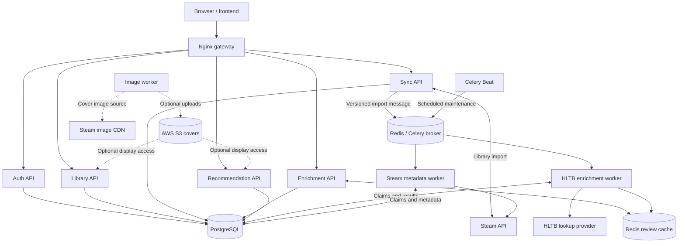
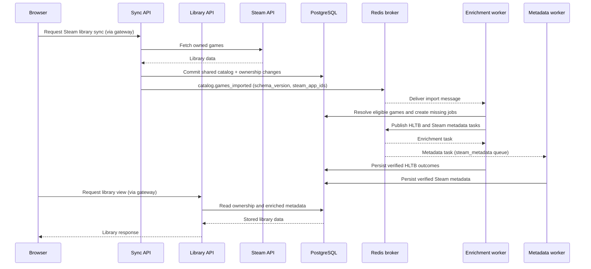
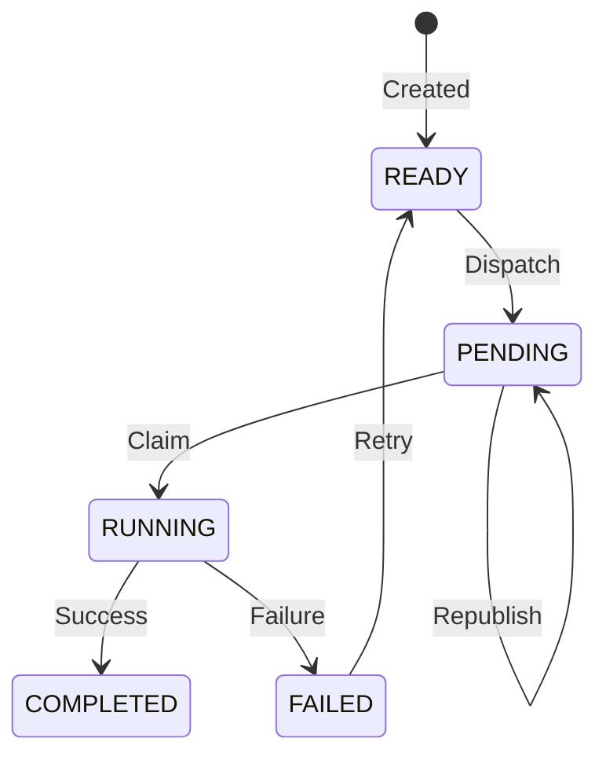
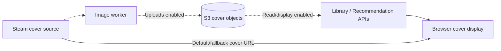

# Backlog Beater — System Architecture

> **Scope:** Current application architecture, key data flows, reliability mechanisms, and known tradeoffs. This document describes the design, not a chronological implementation log. Some infrastructure, including AWS S3 cover storage, is optional and enabled selectively for local demonstrations.
>
> **Implementation references:** [`compose.yml`](compose.yml), [`backend/`](backend/), [`gateway/`](gateway/), and the existing operational notes in [`backend/README.md`](backend/README.md).

## 1. Overview

Backlog Beater helps users import and manage Steam game libraries, track play progress, review ambiguous HowLongToBeat (HLTB) matches, and choose games using stored completion-time estimates and Steam metadata.

The application deliberately separates **interactive HTTP requests** from **slow external lookups**:

- **FastAPI services** handle authentication, library management, synchronization, match review, and recommendations.
- **PostgreSQL** is the source of truth for shared games, user-specific state, and durable background-job records.
- **Redis** brokers Celery messages and supports limited coordination/caching; queued messages are not treated as durable job completion state.
- **Celery workers** perform HLTB and Steam metadata work asynchronously; **Celery Beat** schedules periodic maintenance.
- An **optional image worker and AWS S3 integration** provide cloud-backed cover storage when explicitly enabled. The default local workflow does not require AWS credentials.

The services are separately containerized but **share a PostgreSQL database and some models**. This is a modular application, not a database-per-service microservices system.

## 2. High-level architecture

**How to read this diagram:** Solid edges show primary request/data-processing paths. Dashed S3 edges are **implemented but opt-in**, not planned-only features. The diagram omits some internal queue routing and image metadata persistence for readability; it should not be interpreted as a network-security diagram.

### Service responsibilities

| Component | Responsibility |
| --- | --- |
| **Nginx gateway** | Frontend entry point, API routing, and authentication checks for protected endpoints. |
| **Auth API** | Accounts, identity, token verification, and Steam account linking. |
| **Library API** | Owned games, progress, Play Next ordering, personal preferences, and effective completion estimates. Ordinarily reads stored data rather than calling Steam on each view. |
| **Sync API** | Fetches/imports Steam libraries and announces committed catalog imports. |
| **Enrichment API** | Exposes match-review candidates and records per-user HLTB selections. |
| **Recommendation API** | Reads eligible owned games and produces deterministic, time/genre-based recommendations; personal preference mutations remain in the Library API. |
| **Enrichment worker** | Processes import messages and HLTB jobs, including ambiguity/review refresh and persisted job transitions. |
| **Metadata worker** | Collects Steam Store metadata (such as genres, modes, free status, trailers) on its own queue. |
| **Celery Beat** | Schedules maintenance tasks; only one Beat instance should run for this schedule. |
| **Image worker / S3** | Optional cover-image ingestion and object storage/display integration. |

## 3. Data ownership and storage

**PostgreSQL** stores two kinds of data:

1. **Shared catalog data:** Game identity and catalog fields, Steam metadata, HLTB match outcomes/estimates, and background-job records. Work for the same catalog game can be reused across users.
2. **User-scoped data:** Ownership, completion progress, Play Next ordering, recommendation visibility preferences, and personal HLTB match overrides.

A user's HLTB override takes precedence over shared estimates for that user without changing another user's result. Recommendation reads join the user's ownership and override records; they do not treat shared catalog presence as proof of ownership.

**Redis has distinct responsibilities:**

- **Broker:** Celery messages for event handling and background tasks.
- **Coordination:** Request pacing, cooldowns, and some short-lived ownership/refresh controls.
- **Cache:** Shared match-review shortlists with an expiration (24 hours in the documented implementation).

PostgreSQL retains authoritative job status even if a broker message is lost or redelivered. Redis is not the database of record for user libraries or job outcomes.

## 4. Steam import → enrichment

The import event is a **versioned Celery task contract**, not a fan-out event bus. Its documented task name is `catalog.games_imported` and the payload contains `schema_version: 1` and positive `steam_app_ids`. The consumer validates the schema and IDs, deduplicates IDs in a message, and creates missing jobs for eligible catalog records.

**Why publish an event?** Steam library ingestion does not need to wait for slow HLTB/Store requests. The sync service owns the import, while enrichment components own eligibility and processing. Separate user imports of the same game converge on shared catalog work.

**Important limitation:** The import transaction currently commits **before** publishing the message. A crash between those actions may leave committed games without the corresponding enrichment event. A later sync can reannounce them; a **transactional outbox or reconciliation** mechanism remains a planned reliability improvement.

## 5. Durable background jobs
Backlog Beater uses PostgreSQL-backed job records and Celery workers to coordinate asynchronous enrichment. PostgreSQL maintains durable job state, while Redis acts as the message broker.

### Job Lifecycle

**State transitions:**

- **Created → READY:** An eligible game is identified and a missing enrichment job is created.
- **READY → PENDING:** The dispatcher reserves publication and generates a new attempt token.
- **PENDING → RUNNING:** A worker atomically claims the job using the matching attempt token.
- **PENDING → PENDING:** An eligible pending attempt is republished after its publication cooldown.
- **RUNNING → COMPLETED:** The worker commits a valid result and marks the job as completed.
- **RUNNING → FAILED:** A terminal error or execution timeout causes the job to fail.
- **FAILED → READY:** An explicit retry or eligible bounded retry resets the job for another attempt.

### Claim and execution protocol

1. **Create/dispatch:** Eligible games create missing jobs without resetting existing work. A dispatcher locks a bounded set of rows using `FOR UPDATE SKIP LOCKED`, reserves the attempt in PostgreSQL, then publishes lightweight messages containing `game_id` and `attempt_token`.
2. **Claim:** A worker conditionally changes the matching `PENDING` attempt to `RUNNING`. Duplicate or stale messages that cannot claim the current token stop before expensive provider work.
3. **External I/O:** The worker avoids holding an open database transaction while waiting on an external HLTB/Steam call.
4. **Commit:** The worker reloads and locks relevant state, checks its attempt token and game snapshot, and commits the lookup outcome and final job status together.
5. **Recovery:** Beat-driven maintenance revisits eligible pending publications and detects timed-out running attempts. Failed work remains visible in PostgreSQL; manual retry or the defined retry policy initiates a fresh attempt.

The design targets **at-least-once message delivery with guarded side effects**, not an unsupported claim of exactly-once Celery delivery. Attempt tokens fence stale workers; database claims prevent multiple workers from legitimately owning the same attempt.

### Periodic scheduling and queues

- **Celery Beat:** Publishes maintenance work approximately every minute.
- **Enrichment queue/worker:** Processes HLTB/import work; the later documented split uses a dedicated concurrency-one HLTB consumer.
- **`steam_metadata` queue/worker:** Handles Steam metadata collection separately, also with a concurrency-one consumer in the documented local deployment.
- **Dispatch batches:** Job maintenance is bounded (the documented dispatch limit is 100 jobs per call).
- **Pending republication:** An eligible pending attempt may be republished after a five-minute interval using the same token. Republishing is safe from duplicate *claimed execution*, but duplicate broker messages are still possible.
- **Running timeout:** The documented timeout is two minutes; timeout handling does not magically cancel an external request already in progress, so fencing remains necessary.

### Provider limits and retries

HLTB requests use conservative Redis-coordinated start spacing and bounded retries for identifiable temporary failures. Steam metadata lookups have their own pacing control. These delays are **application policies**, not claims about official provider quotas. Unknown/malformed results are not silently treated as valid metadata.

## 6. Match review and personal estimates

HLTB matching can produce a resolved match, an ambiguous set of candidates, no match, or an error. The enrichment worker stores a shared lookup outcome; uncertain results can be exposed through the Enrichment API for user review.

- Review shortlists are cached in Redis for a limited time. A cache miss can schedule a background refresh rather than blocking the HTTP request on HLTB.
- A personal selection is saved as a **user-scoped override**. It does not rewrite the shared catalog choice for everyone.
- Library and recommendation reads prefer a personal estimate set when present; missing values in an override are not silently filled from the shared match.

This keeps shared work reusable without allowing one user's decision to change another user's library.

## 7. Recommendations and game metadata

The **Recommendation API** reads existing database data; it does not call Steam or HLTB during the recommendation request. It combines ownership, progress, Steam genres/modes, HLTB estimates, personal overrides, and saved queue information.

The documented policy is intentionally deterministic:

- Consider eligible, not-started games with verified single-player support and a resolved completion estimate for the selected goal.
- Apply the selected time budget (`weekly_hours × target_weeks`) strictly rather than silently relaxing it.
- Rank by preferred-genre fit, then budget utilization, with stable tie-breaking.
- Return paginated sets of up to three recommendations while preserving existing Play Next state unless the user explicitly takes an action.
- Respect persistent personal hiding and the documented free-to-play/test-build filtering; unknown metadata is handled explicitly instead of inferred.

Steam trailers use stored metadata and stream from Steam's CDN; they are **not stored in S3**.

## 8. Cover images and optional AWS S3

Cover images can originate from Steam CDN URLs. The application also includes a separate **implemented S3 cover integration**, configured only when needed for testing or demos.

- **Upload configuration:** [`compose.s3-upload.yml`](compose.s3-upload.yml) can mount a local AWS profile into the image worker. The existence of this override **does not turn uploads on**; `S3_UPLOADS_ENABLED` defaults to false.
- **Display configuration:** [`compose.s3-display.yml`](compose.s3-display.yml) supplies a separately configured read-only profile to Library and Recommendation APIs. The documented intended permission is `s3:GetObject` for cover objects.
- **Cost control:** S3 is selectively enabled for demonstrations rather than required for routine local development. Disabling requests limits further activity but does not itself delete stored objects or eliminate existing storage charges.
- **Boundary:** S3 stores cover images when enabled, not video trailers. Avoid committing AWS credentials or treating a local profile-mount override as production credential management.

The dotted connections denote **optional runtime configuration**, not incomplete implementation.

## 9. Security and isolation

Nginx handles protected routing and forwards verified identity to internal APIs rather than trusting a user-supplied identity header. Library mutations and recommendation data are scoped to the authenticated owner. Backend services are exposed through internal container networks rather than all receiving public HTTP ports.

Database queries keep personal overrides, ownership, progress, and recommendation preferences user-scoped. The S3 display configuration is designed around read-only credentials, distinct from upload credentials. These choices reduce accidental cross-user data exposure and unnecessary cloud permissions; they do not replace a complete security audit.

## 10. Tradeoffs and remaining work

| Decision | Benefit | Tradeoff / next step |
| --- | --- | --- |
| Shared PostgreSQL schema/models | Simple local operation and consistent transactions | Coupling between service data models; not independent databases. |
| Versioned Celery import message | Decouples sync from slow enrichment | The post-commit publish window needs an outbox or reconciliation. |
| PostgreSQL job state + Redis transport | Durable claims and recovery; duplicate-delivery protection | More state-machine complexity and occasional duplicate publication. |
| Provider pacing and bounded retries | Avoids uncontrolled external traffic | Throughput is intentionally limited; opaque provider errors may be hard to classify. |
| Deterministic recommendation rules | Explainable, reproducible results | No learned personalization or ranking snapshot across pages. |
| Optional S3 cover storage | Demonstrates cloud storage without requiring AWS for local runs | Opt-in configuration, credentials, storage/request costs, and fallback handling. |

**Further evidence to publish:** repeatable queue-throughput and latency benchmarks, fault-injection scenarios, and documented post-crash recovery results. No production-scale throughput or availability claim is made without measured evidence.

## 11. Source map

| Area | Repository path |
| --- | --- |
| Runtime topology | [`compose.yml`](compose.yml) |
| Service code and workers | [`backend/`](backend/) |
| Gateway routing | [`gateway/`](gateway/) |
| Frontend | [`frontend/`](frontend/) |
| Optional S3 upload | [`compose.s3-upload.yml`](compose.s3-upload.yml) |
| Optional S3 display | [`compose.s3-display.yml`](compose.s3-display.yml) |
| Setup, migrations, tests | [`backend/README.md`](backend/README.md) |

For local setup and commands, use the backend operational README. Historical rollout steps, temporary backup paths, and test-run logs belong in development notes rather than this current-state architecture overview.
